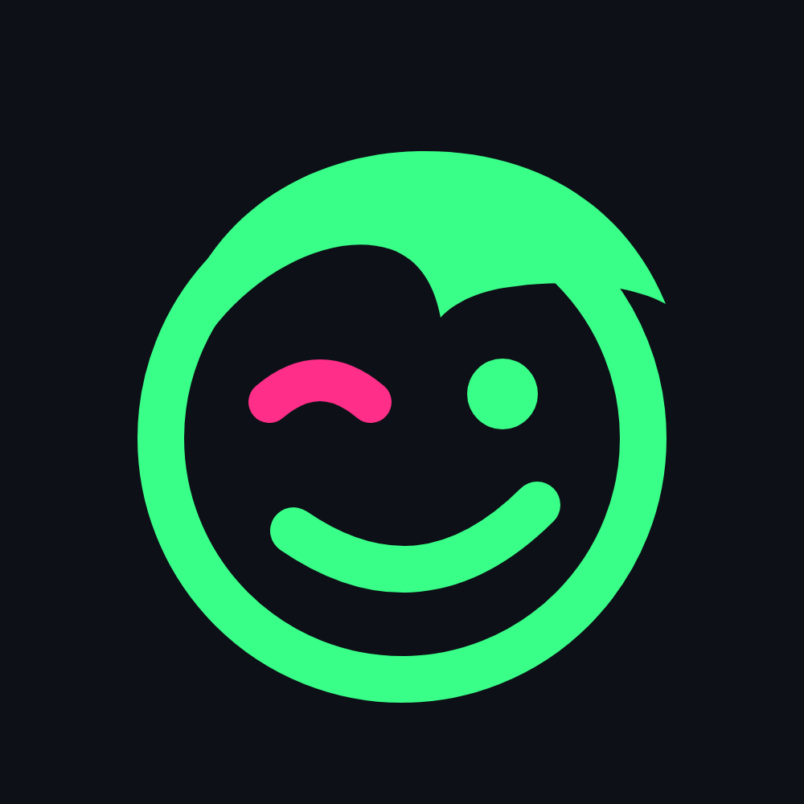
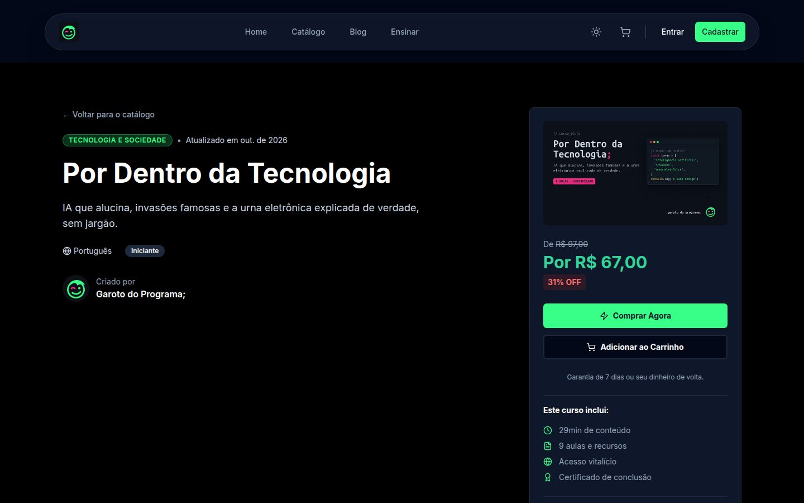
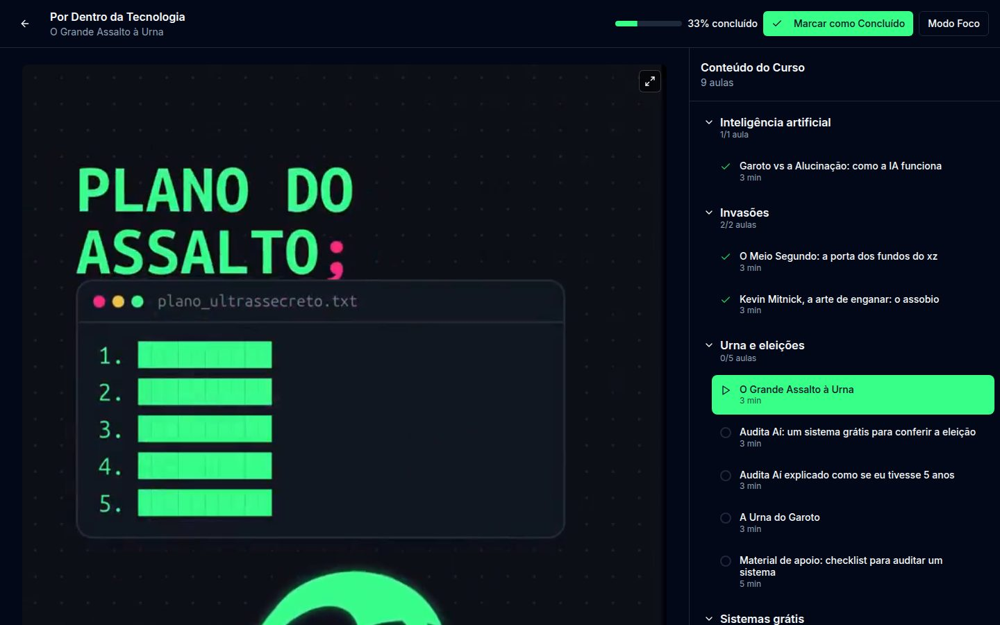
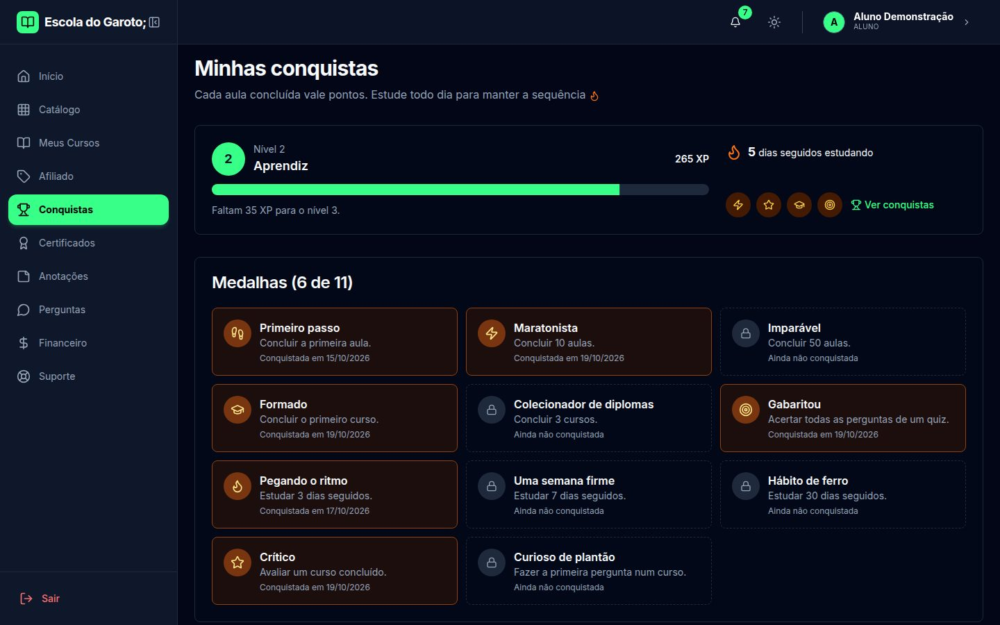
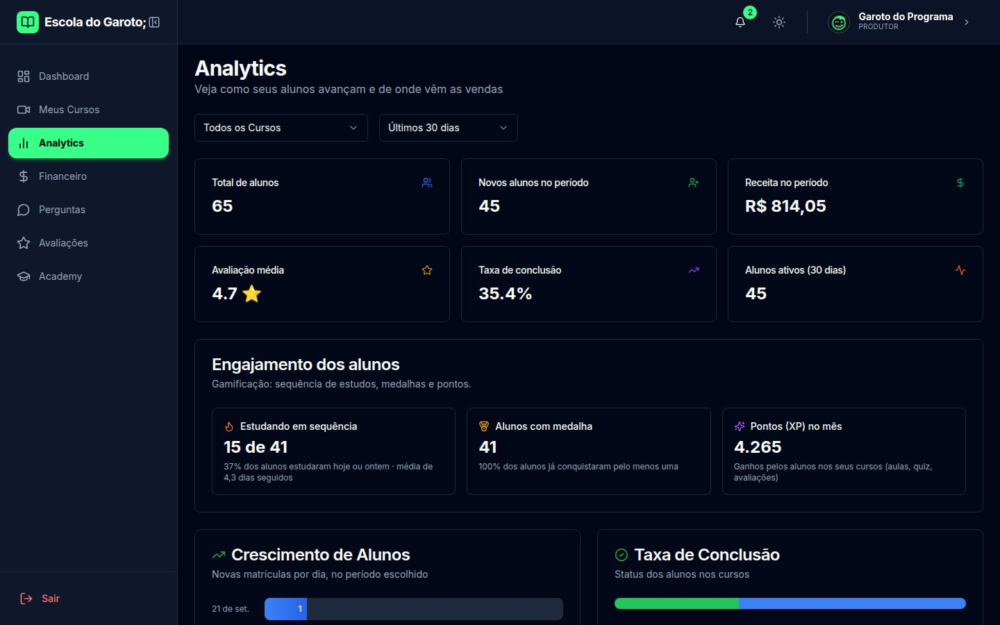
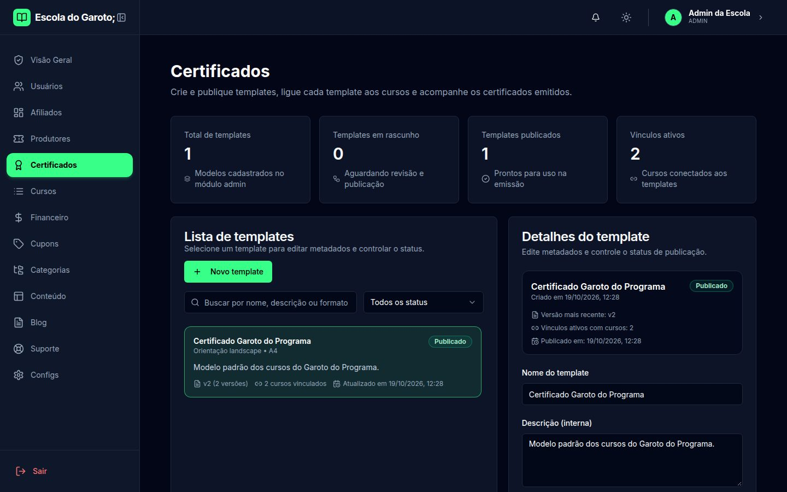
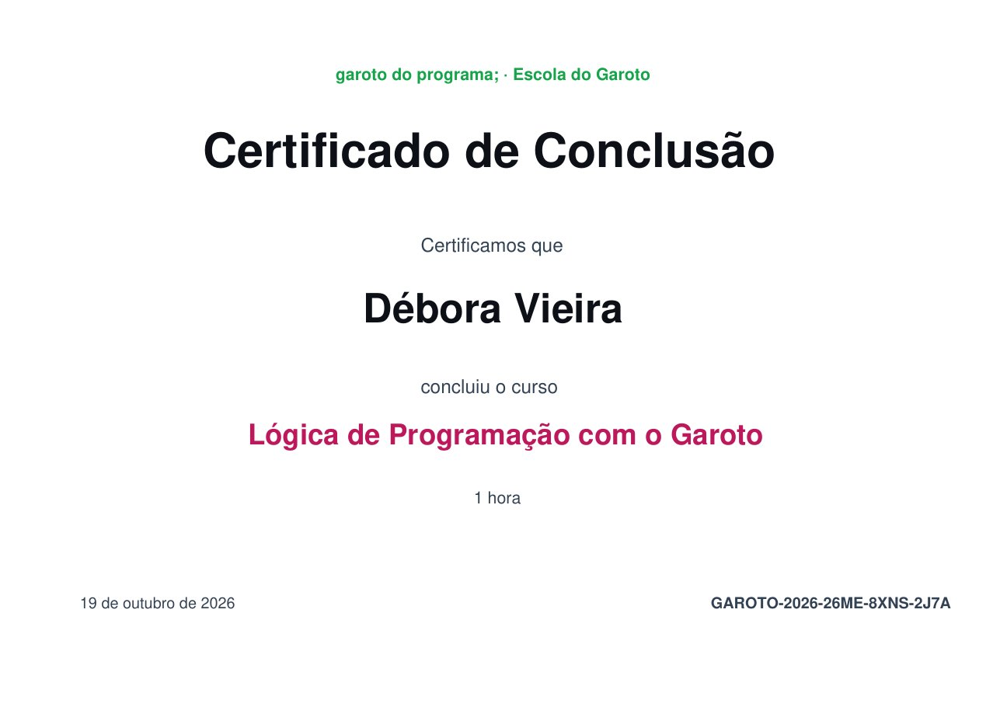

<p align="center">
  
</p>

<h1 align="center">Escola do Garoto;</h1>

<p align="center">
  Uma plataforma de cursos online completa: catálogo, player, quiz, certificado em PDF,<br>
  gamificação, área do produtor, afiliados e painel de administração. Grátis e de código aberto.
</p>

<p align="center">
  <a href="../../actions/workflows/verificacao.yml"></a>
  
  
  
  
</p>

| Página do curso                                               | Player do aluno                                      | Minhas conquistas                                   |
| ------------------------------------------------------------- | ---------------------------------------------------- | --------------------------------------------------- |
|                     |           |    |
| **Analytics do produtor**                                     | **Certificados (admin)**                             | **Certificado em PDF**                              |
|  |  |  |

<sub>Capturas do modo de demonstração, com aulas do canal Garoto do Programa;. Os alunos, as notas e as vendas são fictícios.</sub>

## Visão geral

A Escola do Garoto; é uma plataforma de ensino a distância para quem quer vender (ou dar de graça) os
próprios cursos sem depender de plataforma alheia. O aluno compra, assiste, faz quiz, ganha pontos e
recebe o certificado; o produtor cria o curso em cinco passos e acompanha vendas e engajamento; o admin
aprova cursos, emite certificados e cuida do resto.

Tudo roda em um servidor só, com Docker Compose. Sem mensalidade, sem taxa por aluno (a não ser a do meio
de pagamento, que dessa ninguém escapa).

## O que ela faz

| Quem          | O que consegue fazer                                                                                                                                           |
| ------------- | -------------------------------------------------------------------------------------------------------------------------------------------------------------- |
| **Visitante** | catálogo com filtros, busca, página do curso com prévia grátis, perfil do instrutor, blog e verificação de certificado pelo código                             |
| **Aluno**     | comprar com cupom, assistir (vídeo, texto, PDF, YouTube, Vimeo), fazer quiz, anotar, perguntar, avaliar, baixar o certificado e acompanhar as conquistas       |
| **Produtor**  | criar e editar cursos (módulos, aulas, quiz), responder perguntas e avaliações, ver vendas, engajamento e Analytics, pedir saque                               |
| **Afiliado**  | gerar links rastreáveis, acompanhar cliques e comissões, pedir saque                                                                                           |
| **Admin**     | aprovar cursos, usuários, categorias, cupons, blog, banners, construtor de certificados, suporte em tempo real, financeiro e configurações (nome, cores, logo) |

### Gamificação

- **Pontos:** aula concluída, quiz aprovado (e gabaritado), curso concluído, avaliação e pergunta.
  Cada coisa pontua uma vez só (refazer a aula não vale ponto de novo, foi mal).
- **Níveis** com nome (Iniciante, Aprendiz, Curioso...), **sequência de dias** estudando e **11 medalhas**.
- **Ranking do mês por curso**, só com primeiro nome e inicial, e quem quiser pode sair dele.
- O produtor vê o engajamento dos alunos no Analytics.

## Como é feita

```
 navegador ──► Caddy (HTTPS) ──► Next.js (telas)  ──┐
                       └──────► NestJS (API /api) ◄─┘──► PostgreSQL
                                     └──► arquivos (disco/volume)
```

| Parte     | Tecnologia                                          | Onde                 |
| --------- | --------------------------------------------------- | -------------------- |
| Telas     | Next.js 16 (App Router), React 19, Tailwind e Radix | `apps/web`           |
| API       | NestJS 12 e Drizzle ORM                             | `apps/api`           |
| Banco     | PostgreSQL 17                                       | `infra/`             |
| Contratos | tipos e schemas zod compartilhados                  | `packages/contracts` |

O front nunca fala com o banco: tudo passa pela API, que exige login em toda rota (a não ser as marcadas
como públicas) e valida toda entrada. Detalhes em [`docs/arquitetura.md`](docs/arquitetura.md), o que cada
área faz em [`docs/areas/`](docs/areas/README.md) e as decisões em [`docs/decisoes.md`](docs/decisoes.md).

## Rodando no seu computador

Precisa de **Node 24**, **pnpm** e **Docker ou Podman** (para o Postgres).

```bash
pnpm install
cp apps/api/.env.example apps/api/.env
cp apps/web/.env.example apps/web/.env.local
pnpm db:up                         # Postgres
pnpm db:migrate && pnpm db:seed    # tabelas e dados de exemplo
pnpm dev                           # API em :3333 e site em :3000
```

O seed cria três contas de exemplo (senha `senha-dev-123`, que só funciona com o banco na sua máquina):
`admin@escola.local`, `produtor@escola.local` e `aluno@escola.local`.

Quer ver tudo cheio, com cursos, alunos, notas e certificados? Ligue `DEMO_MODE=true` no `.env` da API e
rode `pnpm db:seed:demo` (passo a passo em [`docs/deploy.md`](docs/deploy.md)).

```bash
pnpm check    # tipos e lint de todos os pacotes
pnpm build    # build de produção
```

## Colocando no ar

Guia completo em [`docs/deploy.md`](docs/deploy.md): Docker Compose com Caddy (HTTPS automático), ou atrás do
Traefik de um servidor com Coolify. Pagamento pelo **Mercado Pago** (Pix e cartão) e e-mail por SMTP.

## Segurança

Sessão por cookie `HttpOnly`, senha com Argon2id, proteção contra CSRF, limite de tentativas por IP,
por conta e por sessão, validação de toda entrada, respostas só com os campos necessários e webhook de
pagamento assinado e idempotente. O panorama está em [`docs/seguranca.md`](docs/seguranca.md). Achou uma
falha? Veja a [política de segurança](SECURITY.md) (e por favor, não abra issue pública).

## Contribuindo

Leia o [`CONTRIBUINDO.md`](CONTRIBUINDO.md). Mudanças relevantes ficam no [`CHANGELOG.md`](CHANGELOG.md).

## Licença

[GPL-3.0](LICENSE). Pode usar, estudar, mudar e distribuir; quem distribuir uma versão modificada abre o
código também.

<p align="center"><sub>do canal <a href="https://github.com/garotodoprograma404">Garoto do Programa;</a> · código, tecnologia e humor duvidoso;)</sub></p>
